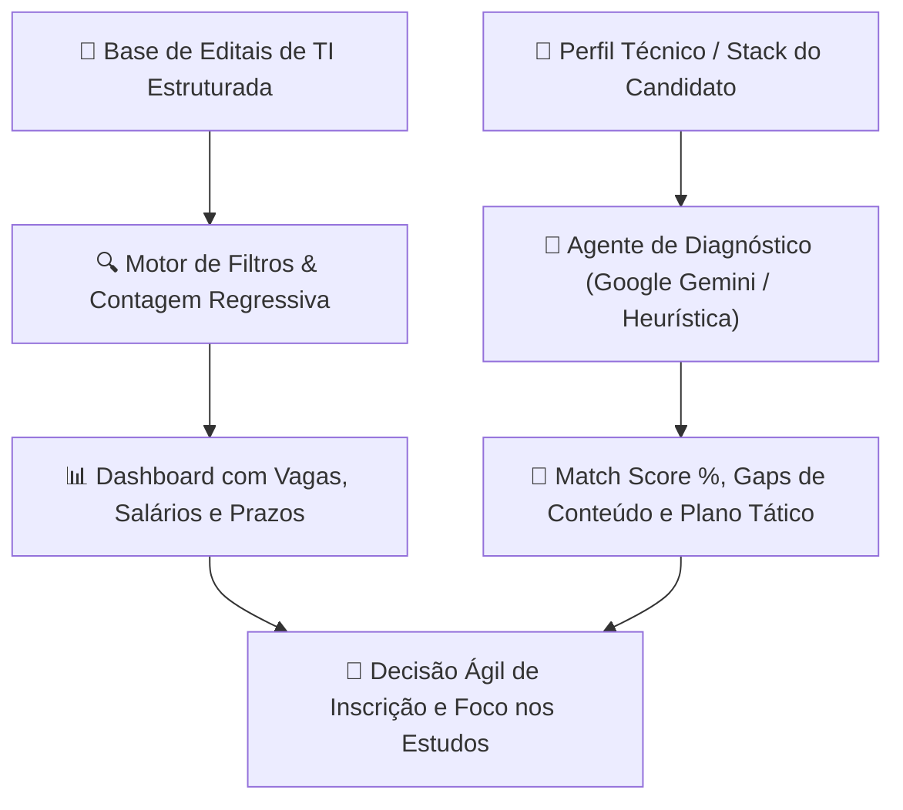

# 🎯 Radar Concursos TI — Monitor de Editais & Matcher de Perfil por IA

<p align="center">
  
  
  
  
  
</p>

Plataforma inteligente para **monitoramento em tempo real de editais de concursos públicos de Tecnologia da Informação no Brasil** com um **agente de diagnóstico e compatibilidade de perfil movido por IA**.

O sistema ajuda profissionais e estudantes de tecnologia a identificarem as melhores oportunidades no serviço público (salários de R$ 9.000 a mais de R$ 20.900), calculando a aderência técnica do candidato com cada edital e montando um roteiro tático para cobrir os gaps de estudo.

---

## 💡 O Problema de Negócio

O setor público brasileiro vive um dos maiores ciclos de contratação de profissionais de TI da história (Bacen, BNDES, Serpro, Dataprev, Tribunais Federais e CNU). No entanto, candidatos enfrentam sérias dificuldades:
1. **Dispersão de Editais:** Informações fragmentadas em dezenas de sites de bancas examinadoras (Cebraspe, FGV, Cesgranrio, FCC).
2. **Prazos Perdidos:** Inscrições curtas e datas de prova que se sobrepõem.
3. **Falta de Direcionamento Estratégico:** Candidatos perdem meses estudando conteúdos genéricos em vez de priorizar as disciplinas com maior taxa de acerto e peso para o seu perfil técnico prévio.

---

## ⚡ Como Funciona a Solução



---

## 🚀 Funcionalidades Principais

* **📡 Radar Centralizado de Editais:**
  - Catalogação das principais oportunidades de TI no Brasil: **Bacen (R$ 20.924)**, **BNDES (R$ 20.900)**, **STJ (R$ 13.994)**, **TRTs (R$ 14.852)**, **Serpro (Remoto)**, **Dataprev**, **Petrobras** e **CNU Bloco 2**.
  - Acompanhamento de vagas imediatas, cadastro de reserva, remuneração inicial e bancas.

* **⏳ Monitoramento de Prazos & Contagem Regressiva:**
  - Alerta dinâmico de dias restantes para o encerramento de inscrições e dias até a data da prova.

* **🧠 AI Profile Matcher (Compatibilidade com IA):**
  - O candidato informa sua experiência (ex: *"sou dev backend Python, uso Docker e SQL"*).
  - A IA calcula o **Match Score (%)** com cada edital, lista as tecnologias já dominadas e aponta exatamente os **gaps técnicos e regulatórios** a estudar.
  - Gera um **Plano Tático de Estudos** e uma **Dica de Ganho Rápido de Pontos** voltada para o estilo da banca.

* **🔍 Filtros Multidimensionais:**
  - Filtro por faixa salarial mínima (R$ 8k a R$ 20k+), status (inscrições abertas, publicado, previsto) e tecnologias específicas (Python, Java, Cloud, Docker, LGPD, etc.).

* **💻 Interface Moderna e Responsiva:**
  - Desenvolvida com **Tailwind CSS**, dark mode nativo e suporte a dispositivos móveis.

---

## 🛠️ Stack Tecnológica

* **Backend:** Python 3.10+ / Flask / Werkzeug
* **Inteligência Artificial:** Google Gemini 2.5 Flash (`google-genai`) com motor de fallback analítico ponderado
* **Frontend:** HTML5 semântico, JavaScript ES6 assíncrono e Tailwind CSS
* **Dados:** Catálogo estruturado JSON com normalização temporal automática

---

## 📂 Estrutura do Repositório

```
radar-concursos-ti/
├── core/
│   ├── radar.py          # Mecanismo de busca, filtros e estatísticas
│   └── matcher.py        # Agente de compatibilidade e recomendação com IA
├── data/
│   └── editais.json      # Catálogo estruturado de editais de TI
├── web/
│   ├── templates/
│   │   └── index.html    # Dashboard web responsivo com tema escuro
│   └── app.py            # Servidor Flask e rotas da API REST
├── test_pipeline.py      # Testes automatizados de ponta a ponta
├── requirements.txt      # Dependências do projeto
└── README.md             # Documentação completa
```

---

## 🏃 Como Executar Localmente

### 1. Clonar o repositório
```bash
git clone https://github.com/CauaRibeiroXY/radar-concursos-ti.git
cd radar-concursos-ti
```

### 2. Instalar dependências
```bash
pip install -r requirements.txt
```

### 3. (Opcional) Configurar Chave Gemini
Defina sua chave de API para habilitar as recomendações avançadas da IA:
```bash
# Windows PowerShell
$env:GEMINI_API_KEY="sua_chave_aqui"

# Linux / Mac
export GEMINI_API_KEY="sua_chave_aqui"
```
*(Nota: Caso não configure a chave, o sistema opera automaticamente com o motor analítico heurístico local embutido).*

### 4. Iniciar a aplicação
```bash
python web/app.py
```

Acesse no seu navegador: **`http://localhost:5060`**

---

## 👤 Autor

Desenvolvido por **[Cauã Ribeiro](https://github.com/CauaRibeiroXY)**  
*Acadêmico de Ciência da Computação (IFNMG) • AI Builder & Engenheiro de Software*
